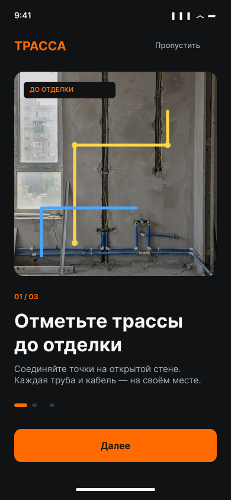
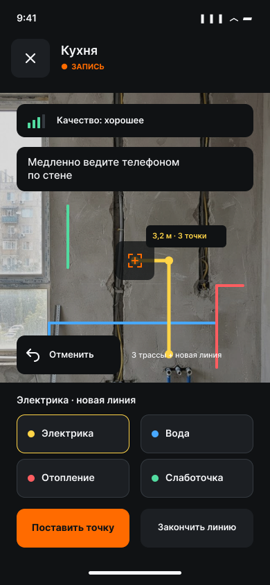
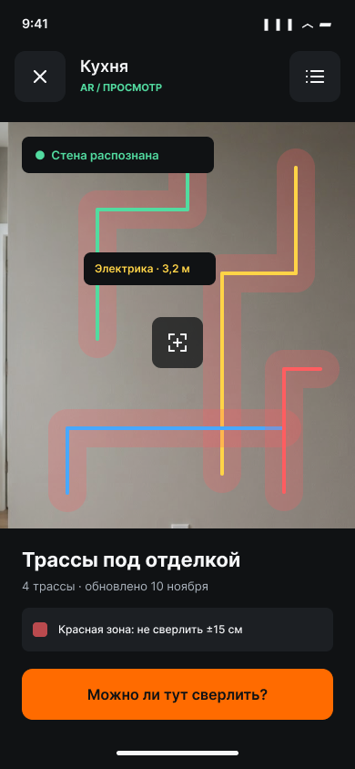
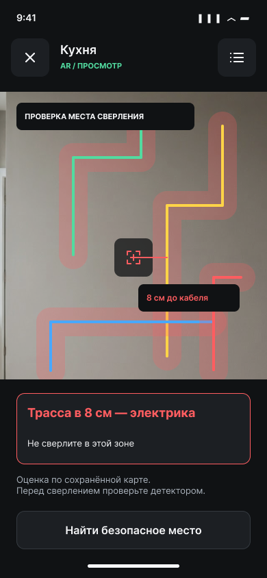

# Трасса — AR-карта труб и кабелей в стенах

> Стены помнят. Вы — спокойны.

iOS-приложение, которое запоминает, где в стенах проходят трубы и кабели, и показывает их через камеру на готовой стене, даже спустя месяцы после ремонта.

<p>
  
  
  
  
</p>

## Проблема

На черновом этапе ремонта все трассы на виду: штробы, гофра, трубы. После шпаклёвки, покраски и плитки их уже никто не помнит, а мебельщики и сами жильцы сверлят «наугад» и повреждают кабели и трубы.

### Что показали CustDev-интервью с прорабами

- **Никто не помнит трассы после чистовой отделки.** Ни заказчик, ни следующая бригада, ни иногда сам прораб.
- **Фото штроб в галерее не помогают.** Снимок нельзя точно наложить на готовую стену: нет масштаба и привязки, непонятно, от какого угла мерить.
- **Повреждения случаются при сверлении под мебель**: кухонные шкафы, полки, телевизор. Мебельщику нужна простая схема, где сверлить нельзя.
- **Исполнительные схемы на бумаге теряются** и редко отражают фактическую прокладку.

Вывод: нужен инструмент, который привязывает трассы к самой стене и показывает их на месте, а не на фото.

## Как работает

1. **Запись до отделки.** Пользователь наводит прицел на открытую стену, выбирает тип трассы (электрика, вода, отопление, слаботочка) и ставит точки. Точки соединяются в линию. Каждая точка становится `ARAnchor`.
2. **Сохранение комнаты.** Приложение ждёт, пока ARKit наберёт достаточно опорных точек (`worldMappingStatus == .mapped`), и сохраняет `ARWorldMap` в файл вместе со всеми якорями, а трассы и снимок-превью кладёт в SwiftData.
3. **Просмотр после ремонта.** Карта загружается в `initialWorldMap`, на экране появляется подсказка «Наведите на ту же стену…». Когда ARKit узнаёт комнату (релокализация), трассы появляются на прежних местах, а вокруг них рисуется полупрозрачная красная зона ±15 см.
4. **«Можно ли тут сверлить?»** Приложение считает расстояние от точки прицела на стене до ближайшего отрезка трассы. Если оно меньше 15 см, появляется красная плашка «Трасса в 8 см — электрика» и телефон слегка вибрирует. Иначе плашка зелёная, «Безопасно».
5. **Экспорт в PDF для мебельщика:** схема с зонами запрета, превью, таблица трасс, фото штроб и заметки.

## Функции MVP

| | Функция |
|---|---|
| ✅ | Объекты и комнаты: создать, переименовать, удалить (долгое нажатие или меню «…») |
| ✅ | AR-запись: прицел, 4 типа трасс с цветами из макета, точки, линии, отмена последней точки |
| ✅ | Индикатор трекинга (`ARCamera.TrackingState`) с подсказками на русском |
| ✅ | Сохранение комнаты: `ARWorldMap` + `ARAnchor` + превью; сохранять можно только при статусе `.mapped` |
| ✅ | Релокализация, линии трасс и красная зона ±15 см |
| ✅ | Проверка места сверления и вибрация при опасности |
| ✅ | Список трасс, карточка трассы (описание, заметка, фото штробы), заметки к комнате |
| ✅ | Экспорт схемы в PDF и отправка через системное меню «Поделиться» |
| ✅ | LiDAR: если он есть, включается `sceneReconstruction = .mesh`; без LiDAR всё тоже работает |

## Дизайн

Макет в Figma: **[Трасса — макет](https://www.figma.com/design/qgUuRBGVowgsUHiUMZ25Tz/%D0%BC%D0%B0%D0%BA%D0%B5%D1%82?node-id=0-1)**

Все токены вынесены в [`Trassa/Theme/Theme.swift`](Trassa/Theme/Theme.swift):

| Токен | Значение |
|---|---|
| Фон / карточки / обводка | `#101214` / `#1C1F23` / `#34393F` |
| Текст / вторичный | `#F6F7F9` / `#AAB2BC` |
| Акцент | `#FF6B00` |
| Электрика / Вода / Отопление / Слаботочка | `#FFD447` / `#48A8FF` / `#FF5D60` / `#52DBA0` |
| Зона запрета | `#FF5D60`, 24 % |
| Шрифт | Inter 400/500/600/700 (в бандле, лицензия OFL) |
| Отступы / радиус / кнопки | 24 pt / 12 pt / 56 pt (touch target) |

Остальные экраны из макета лежат в [`docs/screens`](docs/screens).

## Стек

- Swift 5, SwiftUI, iOS 17+
- ARKit (`ARWorldTrackingConfiguration`, `planeDetection = .vertical`, raycast от центра экрана, `ARWorldMap`, `ARAnchor`) и RealityKit (`ARView`, отрисовка линий и зон)
- SwiftData: объекты, комнаты, трассы, точки, заметки, фото. Без сервера и регистрации, всё хранится на устройстве.
- `UIGraphicsPDFRenderer` для экспорта в PDF
- XCTest

## Структура

```
Trassa/
├── App/         точка входа, навигация (Router)
├── Theme/       Theme.swift — цвета, шрифты, размеры из Figma
├── Models/      SwiftData-модели (Project, Room, Route, RoutePoint, RoomNote), RouteType, черновики записи
├── AR/          ARSessionController (сессия, raycast, якоря, карта), RouteRenderer (линии и зоны), TrackingHint
├── Services/    Geometry (точка–отрезок), WorldMapStore (файлы карт), RoomRepository, Schematic, PDFExporter, Haptics
├── Views/       Onboarding, Projects, Rooms, Record, Viewer, Routes, Export, Components
└── Resources/   шрифты Inter
TrassaTests/     GeometryTests, PersistenceTests
```

## Как запустить на iPhone

> AR **не работает в симуляторе**: ARKit нужна настоящая камера. В симуляторе открываются только списки, карточки и экспорт.

Требования: Mac с **Xcode 16 или новее**, iPhone с **iOS 17+** и процессором A12 или новее (XS / XR и новее), кабель USB-C или Lightning.

1. Склонируйте репозиторий и откройте `Trassa.xcodeproj` в Xcode.
2. Добавьте Apple ID: **Xcode → Settings → Accounts → «+» → Apple ID**. Подойдёт бесплатный аккаунт.
3. Выберите в навигаторе проект **Trassa** → таргет **Trassa** → вкладка **Signing & Capabilities**:
   - включите **Automatically manage signing**;
   - в поле **Team** выберите свой аккаунт (Personal Team);
   - если Xcode пишет, что Bundle Identifier занят, замените `ru.trassa.app` на уникальный, например `ru.<ваше-имя>.trassa`.
4. Подключите iPhone кабелем, разблокируйте его и нажмите «Доверять этому компьютеру».
5. Включите **режим разработчика** на iPhone: **Настройки → Конфиденциальность и безопасность → Режим разработчика → Вкл.**, телефон перезагрузится.
6. Выберите свой iPhone в списке устройств вверху окна Xcode и нажмите **▶ Run** (⌘R).
7. При первом запуске с бесплатным аккаунтом iPhone попросит доверять разработчику: **Настройки → Основные → VPN и управление устройством → ваш Apple ID → Доверять**. Затем снова нажмите ▶ в Xcode.
8. Разрешите доступ к камере.

С бесплатным аккаунтом приложение работает 7 дней, потом его нужно заново установить из Xcode.

### Тесты

```bash
xcodebuild -project Trassa.xcodeproj -scheme Trassa \
  -destination 'platform=iOS Simulator,name=iPhone 16' test
```

Тесты проверяют расстояние от точки до отрезка (внутри, за концами, вырожденный отрезок, 3D), порог 15 см, длину ломаной, русские склонения, а также сохранение и загрузку SwiftData-модели и файла карты, дописывание в комнату и каскадное удаление.

## Советы по записи

- Записывайте при хорошем свете и медленно ведите телефон вдоль стены на расстоянии 0,5–2 м.
- Захватите в кадр **неизменяемые ориентиры**: углы, оконные и дверные проёмы, потолок. После отделки фактура стены меняется, и узнавать комнату ARKit будет по ним.
- Сохраняйте, когда индикатор показывает «Карта готова».

## Ограничения MVP

- **Релокализация после ремонта не гарантирована.** ARWorldMap опирается на визуальные признаки, а после шпаклёвки и покраски стена выглядит иначе. Ориентиры (проёмы, углы) сильно повышают шанс узнать комнату. Если узнать не получилось, поможет PDF-схема.
- **Точность** порядка 1–5 см. Она зависит от освещения, дрейфа трекинга и LiDAR. Результат проверки — подсказка, а не гарантия: **перед сверлением проверяйте детектором проводки**.
- Карта работает только на устройствах с ARKit и только для той комнаты, где её записали. Карты сильно переотделанных или переставленных помещений могут не подойти.
- PDF-схема — плоская развёртка всех трасс на одну плоскость. Для нескольких стен в одной комнате она приблизительная.
- Нет синхронизации и резервного копирования: данные живут на одном iPhone.

## Планы

- Привязка трассы к «реперам» (розетка, угол), чтобы восстанавливать положение, даже если карта не узнана.
- Отдельные схемы по стенам с размерами от углов и пола в PDF.
- Экспорт и импорт комнаты (`.arworldmap` + JSON), чтобы передать её бригаде или заказчику; iCloud-синхронизация.
- Распознавание розеток и выключателей (Vision) для автоматических подсказок.
- Режим «Прораб»: несколько объектов, бригады, история изменений.

## Лицензии

Шрифт Inter © The Inter Project Authors, SIL Open Font License 1.1 (`Trassa/Resources/Fonts/Inter-LICENSE.txt`). Фото в онбординге взяты из макета Figma.
